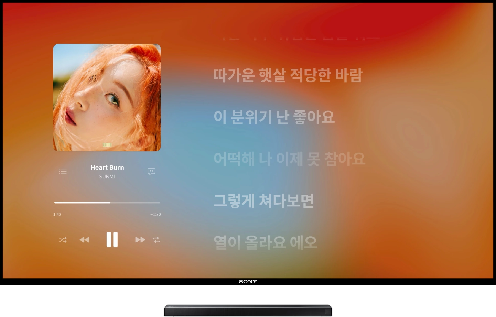
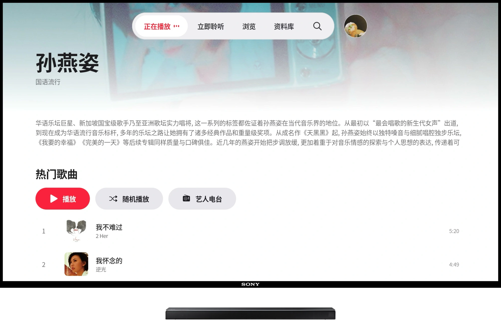

# Apple Music For Android TV

**将喜欢的旋律带入客厅。**  
**Bring your favourite music to the big screen.**

[中文](#中文) · [English](#english) · [官网 / Website](https://applemusictv.pages.dev/) · [上游项目 / Upstream](https://github.com/JObersi10/apple-music-tv)


## 中文

**好音乐，无边界。** 无需 Apple TV，让喜欢的旋律在家里的 Android 大屏上响起。

Apple Music For Android TV 是一个为大屏聆听打造的非官方项目，基于 [JObersi10/apple-music-tv](https://github.com/JObersi10/apple-music-tv) 修改与完善。它针对电视重新设计界面布局和遥控器交互，将熟悉的音乐世界带入客厅。

### 为聆听而设计

- **大屏体验**：为电视与遥控器设计，也适配 Pad、折叠屏等 Android 大屏设备。
- **熟悉的音乐世界**：从个人曲库、专属推荐到歌单、电台和编辑精选，在更大的屏幕上探索喜欢的音乐。
- **流动光影**：从专辑封面中提取色彩，让背景随音乐柔和流动，搭配歌词与封面，营造沉浸式聆听氛围。
- **自在选择**：支持浅色与深色界面，并可从播放页进入封面墙。



### 开始使用

1. 从 [GitHub Releases](https://github.com/lavande16/Apple-Music-For-Android-TV/releases/latest) 或 [官网](https://applemusictv.pages.dev/) 下载 APK，安装到 Android 6.0 或以上的设备。
2. 将手机和电视接入同一 Wi-Fi，按照应用连接页的指引填写自己的 Apple Music 用户令牌。**请像密码一样保护令牌，不要分享或提交到仓库。**
3. 完整聆听需要有效的 Apple Music 订阅；未订阅时仅支持片段试听。

### 从源码构建

准备 JDK 17、Android SDK 35 和 Android Studio，然后执行：

```sh
cd android
./gradlew assembleDebug
```

输出位于 `android/app/build/outputs/apk/debug/`。源码中的 Release 构建配置使用本机 debug 签名配置以兼容原开发环境；其他开发者的本机密钥与官网 APK 的签名不同，通常不能覆盖安装。请自行配置适合自己发布用途的签名。开发与第三方依赖说明见 [CONTRIBUTING.md](CONTRIBUTING.md)、[第三方声明](THIRD_PARTY_NOTICES.md) 和 [Kawarp 声明](THIRD_PARTY_KAWARP.md)。

## English

**Great music belongs on every screen.** Bring your favourite music into the living room on your Android TV—no Apple TV required.

Apple Music For Android TV is an independent, unofficial project built on [JObersi10/apple-music-tv](https://github.com/JObersi10/apple-music-tv). Its interface and remote controls are designed for the big screen.

### Designed for listening

- **Made for the big screen:** browse with a TV remote, and enjoy the experience on Android tablets and foldables too.
- **Your music, together:** explore your library, recommendations, playlists, radio, and editorial selections.
- **Colours in motion:** artwork-inspired colours flow behind the cover and lyrics to create an immersive listening atmosphere.
- **Make it yours:** choose light or dark appearance and open the cover wall from the player.



### Get started

1. Download the APK from [GitHub Releases](https://github.com/lavande16/Apple-Music-For-Android-TV/releases/latest) or the [website](https://applemusictv.pages.dev/) and install it on a device running Android 6.0 or later.
2. Connect your phone and TV to the same Wi-Fi network, then follow the app's connection instructions to enter your own Apple Music user token. **Treat this token like a password; never share it or commit it to a repository.**
3. Full playback requires an active Apple Music subscription. Without one, only previews are available.

### Build from source

Install JDK 17, Android SDK 35 and Android Studio, then run:

```sh
cd android
./gradlew assembleDebug
```

The APK is written to `android/app/build/outputs/apk/debug/`. The archived Release configuration uses the local debug signing configuration to match the original development environment. Your local key will differ from the website APK's signing key, so an in-place upgrade will generally not work. Configure your own signing for releases. See [CONTRIBUTING.md](CONTRIBUTING.md), [third-party notices](THIRD_PARTY_NOTICES.md), and [Kawarp attribution](THIRD_PARTY_KAWARP.md).

## 致谢与许可 / Credits and license

本项目基于 [JObersi10/apple-music-tv](https://github.com/JObersi10/apple-music-tv) 修改，感谢原项目作者及所有贡献者。代码采用 [GPL-3.0](LICENSE)；第三方组件遵循各自许可，详见 [THIRD_PARTY_NOTICES.md](THIRD_PARTY_NOTICES.md)。

This project is modified from [JObersi10/apple-music-tv](https://github.com/JObersi10/apple-music-tv). Thanks to its author and contributors. The code is licensed under [GPL-3.0](LICENSE); third-party components retain their own licenses, as described in [THIRD_PARTY_NOTICES.md](THIRD_PARTY_NOTICES.md).

Apple Music For Android TV 是独立的非官方项目，与 Apple Inc. 无关联，亦未经其认可。Apple Music 及相关商标、音乐与封面的权利归各自权利人所有。本项目仅用于个人学习与研究。

Apple Music For Android TV is an independent, unofficial project, not affiliated with or endorsed by Apple Inc. Apple Music and related trademarks, music, and artwork belong to their respective owners. This project is intended for personal learning and research.
